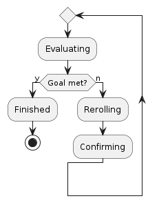
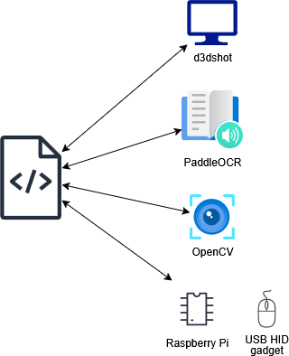
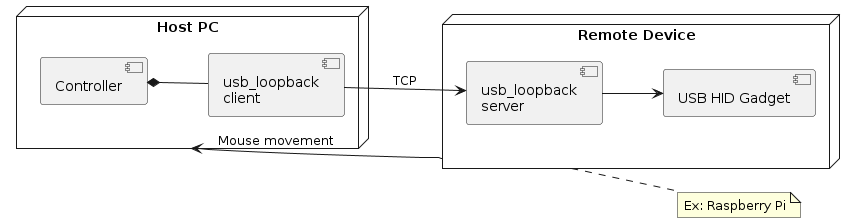

# Auto cuber/flamer

A tool to automate two MapleStory item upgrade flows:

- **Cube** mode re-rolls an item's *potential* until the rank and stat lines
  match a chosen goal.
- **Flame** mode re-rolls an item's *bonus stats* until the weighted flame
  score passes a threshold.

# Installation

```
python -m pip install --no-cache-dir ./cube
```

Run it with:

```
python -m cube
```

There is also a CLI option which provides more/less customization.
```
python -m cube --cli
```

# Architecture

### State machine


## Dependencies



- [PaddleOCR](https://github.com/PADDLEPADDLE/PADDLEOCR)*
- [d3dshot](https://github.com/SerpentAI/D3DShot)
- [usb_loopback]
- [mouse_finder]

>\* Experimented with [tesseract](https://tesseract-ocr.github.io/) which, although faster, had accuracy issues.


## Detection avoidance measures
- Uses [d3dshot](https://github.com/SerpentAI/D3DShot) which is the same API used by OBS for screen capture
- Interfaces with a remote device acting as a USB HID. To a third party, there are simply TCP packets between a local network as well as a USB HID registered as an absolute pointing mouse.



# Verification

- Unit tested with various in-game frames, both modified and unmodified. See [tests/fixtures](./tests/fixtures/)
